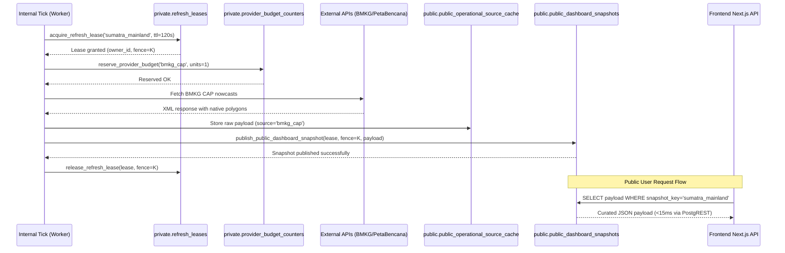

# PLAN — Phase 178: Mainland Sumatra Shadow Pilot (Implementation Plan)

**Window:** 2026-11-05  
**Status:** COMPLETE (Retrospective Architecture & Implementation Record)  
**Milestone:** Post-M9 Operational Grounding  
**Plan Reference:** `.planning/phases/178-mainland-sumatra-shadow-pilot/178-01-PLAN.md`  

---

## 1. Objective

Deliver a bulletproof, research-safe operational architecture for Mainland Sumatra logistics pilot operations. The implementation establishes:
1. High-throughput, low-latency public read path with zero downstream provider latency.
2. Single-writer lease coordination across distributed workers with fencing tokens.
3. Strict provider daily budgeting to avoid quota exhaustion.
4. Grounded multi-source disaster and weather ingestion without synthetic geometry hallucination.
5. Absolute server-enforced safety for research shadow pilots with non-mutating previews.

---

## 2. Scope IN & Scope OUT

### Scope IN
- **Database & Storage (`infra/supabase/`):**
  - Schema migration `20261105060029_public_snapshot_coordination.sql`.
  - Tables: `public.public_dashboard_snapshots`, `public.public_operational_source_cache`, `private.refresh_leases`, `private.public_snapshot_sections`, `private.provider_budget_counters`, `private.provider_budget_reservations`.
  - Stored Procedures: `acquire_refresh_lease`, `release_refresh_lease`, `read_public_snapshot_sections`, `publish_public_dashboard_snapshot`, `complete_scheduled_job`, `reserve_provider_budget`.
  - Strict RLS: public read only for `snapshot_key = 'sumatra_mainland'`, service-role-only for operational coordination.
- **Backend Coordination & Caching Services (`backend/app/services/`):**
  - `refresh_coordinator.py`: Fenced lease manager; handles monotonic fencing tokens to prevent split-brain writes.
  - `public_snapshot_service.py`: Assembles the curated singleton snapshot across 8 mainland provinces; enforces `PUBLIC_FIELDS` projection allowlist.
  - `provider_budget.py`: Fail-closed daily unit reservation per provider source.
  - `public_operational_cache.py`: Raw source persistence and cached read model; handles independent source TTLs.
  - `hazard_evidence.py`: Shared `hazard-evidence-v1` contract separating physical blockages from weather warnings.
  - `observed_disaster_service.py`: Orchestrator for BMKG CAP nowcasts, PetaBencana crowdsourced reports, and BNPB historical records.
  - `pilot_safety.py`: Server-side gatekeeper ensuring shadow preview runs have zero DB mutations in `route_approvals` or `travels`.
- **Ingestion Adapters (`backend/app/adapters/`):**
  - `bmkg_cap_adapter.py`: XML CAP nowcast parser preserving native polygon coordinates without synthesizing artificial radii.
  - `petabencana_adapter.py`: REST parser for crowdsourced disaster points restricted to mainland ISO 3166-2 province codes.
  - `cpu_routing_adapter.py`: Deterministic NetworkX + OR-Tools / 2-Opt CPU routing engine honoring `hazard-evidence-v1` blockages.
- **API Routers (`backend/app/routers/`):**
  - `approvals.py`: Gated by `pilot_safety.py`; returns shadow mock previews when `pilot_shadow_mode` is enabled.
  - `news_router.py`: Public-safe news reads from operational cache without leaking unverified draft states.
  - `travels_router.py`: Tenant-scoped trip inspections with strict ownership checks.
  - `outcomes_router.py`: Ground truth outcomes verification with shadow audit trail tagging.
  - `dashboard_bootstrap.py`: Serves public snapshot sections or tenant overlays based on JWT context.
  - `internal_tick.py`: Scheduled runner executing background refreshes under fenced leases.
- **Frontend Layer (`frontend/`):**
  - `app/api/public/dashboard/route.ts`: Next.js Route Handler querying Supabase PostgREST singleton read with 30s cache and 1.8s timeout.
  - `lib/publicSnapshot.ts`: TypeScript contracts and normalizer for `DashboardBootstrapResponse`.
  - `hooks/useDashboardBootstrap.ts`: Public-first hydration hook falling back to cached snapshot before tenant data loads.
  - `components/dashboard/DashboardClient.tsx`: Master dashboard client binding public snapshot state and shadow mode banners.

### Scope OUT
- No GPU-based solvers (deprecated in Phase 59; deterministic CPU routing only).
- No unverified out-of-Sumatra points (Java, Malaysia, Natuna).
- No live hardware actuation or automated dispatch execution without HITL approval.
- No synthetic circular buffer generation around point alerts.
- No storage of tenant telemetry in the public snapshot table.

---

## 3. Work Packages

| WP | Component | Primary Files | Scope & Responsibilities |
|---|---|---|---|
| **WP1** | **Database Schema & Fenced Coordination** | `infra/supabase/migrations/20261105060029_public_snapshot_coordination.sql` | Migration creating `public_dashboard_snapshots`, `refresh_leases`, `provider_budget_counters`, and PL/pgSQL lease/publish procedures. |
| **WP2** | **Distributed Lease Coordinator & Budget Governor** | `backend/app/services/refresh_coordinator.py`, `backend/app/services/provider_budget.py` | Distributed lock acquisition with monotonic fences, lease heartbeat/expiration, and daily budget counters. |
| **WP3** | **Curated Snapshot Assembly & Operational Cache** | `backend/app/services/public_snapshot_service.py`, `backend/app/services/public_operational_cache.py` | Assembling 12 public sections, projection allowlist filtering (`PUBLIC_FIELDS`), and independent raw source retention. |
| **WP4** | **Disaster Adapters & Grounded Ingestion** | `backend/app/adapters/bmkg_cap_adapter.py`, `backend/app/adapters/petabencana_adapter.py`, `backend/app/services/observed_disaster_service.py` | Bounded parsers for BMKG CAP nowcasts and PetaBencana reports; mainland Sumatra province tagging. |
| **WP5** | **Hazard Evidence & Deterministic Routing** | `backend/app/services/hazard_evidence.py`, `backend/app/adapters/cpu_routing_adapter.py` | `hazard-evidence-v1` evaluation separating verified blockages from weather risks; deterministic routing with 0.1 km tolerance. |
| **WP6** | **Server-Enforced Pilot Safety** | `backend/app/services/pilot_safety.py`, `backend/app/routers/approvals.py`, `backend/app/routers/travels_router.py` | Non-mutating shadow preview interception, tenant ownership verification, and 403 authorization enforcement. |
| **WP7** | **Public Edge Endpoint & Frontend Hydration** | `frontend/app/api/public/dashboard/route.ts`, `frontend/lib/publicSnapshot.ts`, `frontend/hooks/useDashboardBootstrap.ts`, `frontend/components/dashboard/DashboardClient.tsx` | Next.js API route proxying Supabase singleton snapshot, client normalizer, and instant public hydration. |
| **WP8** | **Comprehensive Automated Verification** | `backend/tests/test_hazard_routing_evidence.py`, `test_news_hitl_shadow.py`, `test_observed_disaster_service.py`, `test_pilot_shadow_safety.py`, `test_public_operational_cache.py`, `test_public_snapshot_coordination.py`, `test_shared_news_reads.py` | Unit, integration, and regression test suites validating the end-to-end architecture. |

---

## 4. Architectural Interactions

---

## 5. Verification & Acceptance Targets

- **Target 1: Coordination Fencing Integrity:** When two workers attempt publication under the same lease, only the worker presenting the active, latest fence value succeeds; all stale or superseded writes return `false`.
- **Target 2: Budget Governor Enforcement:** When provider calls exceed the configured daily limit, further reservations are immediately denied (`false`) and the system falls back to cached records with zero network traffic.
- **Target 3: Geometry & Spatial Truth:** No point hazard is converted into an arbitrary 5 km or 10 km circular hazard polygon. Only official boundaries and surveyed footprints are admitted.
- **Target 4: Pilot Shadow Isolation:** Invoking `/api/v1/approvals` in shadow mode returns a valid preview analysis but leaves `route_approvals` table count unchanged.
- **Target 5: Public API Performance:** `/api/public/dashboard` delivers curated mainland operational data within 300 ms on cached hits and < 1.5 s on cold reads.
- **Target 6: Automated Test Suite:**
  - 55 passing unit and integration tests across 7 new test files in `backend/tests/`.
  - 68 passing regression tests across touched routers (`test_dashboard_bootstrap.py`, `test_dashboard_snapshot.py`, `test_internal_tick.py`, `test_news_read_path.py`, `test_trip_linked_approvals.py`).
