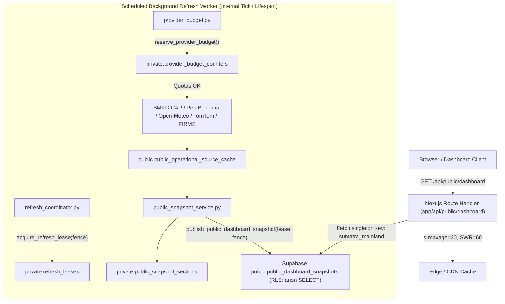

# SPEC — Phase 178: Mainland Sumatra Shadow Pilot

**Status:** APPROVED 2026-11-05  
**Milestone:** Post-M9 Pilot Hardening / Operational Grounding  
**Scope:** Mainland Sumatra Research Pilot, Shared Public-First Projection, Fenced Coordination, Conservative Hazard Evidence & Server-Enforced Shadow Safety  
**Canonical Reference:** `.planning/phases/178-mainland-sumatra-shadow-pilot/178-SPEC.md`  

---

## 1. Goal

Establish a hardened, fail-closed operational pilot architecture for mainland Sumatra logistics corridors (serving pilot research partners across Pelindo Belawan, BKHIT, BPJT tolls, and PIHPS food commodities) that guarantees:

1. **Deterministic Public Projection:** A high-performance, curated, and tenant-free dashboard projection (`public_dashboard_snapshots`) serving anonymous and public requests under 1.5 seconds without invoking upstream third-party APIs or executing live DB writes.
2. **Distributed Fenced Coordination:** Single-writer concurrency control (`private.refresh_leases`) preventing duplicate or competing background refresh workers across distributed server instances (Render, local workers, background jobs).
3. **Atomic Upstream Provider Budgeting:** Fail-closed provider unit reservation (`private.provider_budget_counters`) enforcing hard daily limits per source (Open-Meteo, BMKG, TomTom, FIRMS, PetaBencana) to prevent runaway billing and quota exhaustion.
4. **Conservative Hazard Evidence Contract (`hazard-evidence-v1`):** A strict, non-hallucinatory standard for physical blockage vs. precautionary forecast risk that rejects circular default buffer expansions and requires verified spatial geometry from authoritative agencies.
5. **Server-Enforced Shadow Pilot Safety:** Complete operational ledger isolation (`pilot_safety.py`). Previewing reroutes in shadow mode returns explicit non-mutating preview payloads and strictly forbids creating phantom rows in `route_approvals` or `travels`.

---

## 2. Non-goals

- **No Live Physical Actuation:** The platform does not directly command autonomous vehicles or dispatch physical drivers without human-in-the-loop (HITL) approval.
- **No Operational Ledger Mutation During Shadow:** Shadow evaluation runs must never create, alter, or commit rows to `route_approvals`, `travels`, or driver manifests.
- **No Paid Infrastructure / Quota Overages:** No subscriptions to unbudgeted commercial APIs; all external access operates within fail-closed daily quotas.
- **No Synthetic or Circular Hazard Synthesis:** No arbitrary circular buffers around point coordinates. If an incident lacks authoritative geometry or surveyed bounds, it is classified strictly as an unexpanded point observation or advisory.
- **No Cross-Strait Geographical Bleed:** Geographic bounding strictly enforces the 8 mainland Sumatra provinces and explicitly ignores out-of-scope offshore or cross-strait coordinates (Java, Peninsular Malaysia, Natuna).
- **No Tenant Leaks in Public Feeds:** Public snapshots are stripped of all tenant identifiers (`company_id`, `driver_id`, vehicle telemetry, ERP cost savings, and approval notes).

---

## 3. Decisions Locked Across 8 Pillars

| # | Pillar | Decision & Architectural Rule |
|---|---|---|
| 1 | **Geography** | **Mainland Sumatra Only (8 Provinces):** Aceh, Sumatera Utara, Sumatera Barat, Riau, Jambi, Sumatera Selatan, Bengkulu, and Lampung. Satellite islands with non-contiguous logistics road networks (e.g., Simeulue, Mentawai, Bangka, Belitung) and foreign territories (Peninsular Malaysia, Singapore, Java) are filtered at data ingestion. |
| 2 | **Delivery** | **Public-First Snapshot Projection:** Public frontend routes fetch `/api/public/dashboard` via Next.js edge route backed by Supabase `public.public_dashboard_snapshots` (singleton key `sumatra_mainland`, schema version 1). Reads take `< 1.5s`, cached with `Cache-Control: public, s-maxage=30, stale-while-revalidate=60`. |
| 3 | **Freshness** | **Independent Section Caching & SWR:** Source caches maintain distinct operational TTLs (BMKG Nowcast: 300s; Open-Meteo: 6h; NASA FIRMS: 3h; TomTom Traffic: 30m). Degraded or stale sections retain their last-known-good payload marked with `status: "stale"` or `status: "degraded"`; healthy empty results write `items: []`. |
| 4 | **Sharing** | **Strict Multi-Tenant Isolation:** Public projection is strictly allow-listed (`PUBLIC_FIELDS`). Driver PII, vehicle GPS coordinates, fleet rosters, ERP savings calculations, and approval history are completely segregated to authenticated tenant endpoints with verified `company_id` JWT claims. |
| 5 | **Collection** | **Fenced Leases & Daily Provider Budget:** Refresh jobs acquire durable leases (`acquire_refresh_lease`) with monotonic fences (`fence + 1`). Expired or superseded workers cannot commit snapshot payloads (`publish_public_dashboard_snapshot`). Upstream API calls must atomically reserve daily units via `reserve_provider_budget`. |
| 6 | **Geometry** | **Observed Geometry Provenance:** Geometry sources marked as `generated`, `modeled`, `estimated`, or `synthetic` are rejected for blockage claims. Only verified shapes (`observed`, `official`, `surveyed`, `source_footprint`) are admitted. Point hazards use a strict 0.1 km matching tolerance. |
| 7 | **Routing** | **Deterministic CPU Routing with `hazard-evidence-v1`:** Deterministic NetworkX + OR-Tools / 2-Opt CPU routing adapter in `cpu_routing_adapter.py`. Classifies hazards into four explicit tiers: `CONFIRMED_BLOCKAGE`, `PRECAUTIONARY_RISK`, `UNKNOWN`, and `CLEAR`. Weather nowcasts do not trigger full detour penalties unless accompanied by verified road closures. |
| 8 | **Pilot Mode** | **Fail-Closed Shadow Operation:** Controlled by `pilot_shadow_mode` (default `True`). Shadow reroutes return explicit preview bodies with `shadow_mode: true` and zero DB side effects. Any live approval requires an authenticated Dispatcher role with `fleet:write` permissions and proven tenant record ownership. |

---

## 4. Shared Serving Path



### Shared Public Response Schema (`schema_version: 1`)
- `snapshot_key`: `"sumatra_mainland"`
- `schema_version`: `1`
- `computed_at`: ISO 8601 UTC timestamp
- `stale`: boolean flag (`true` if computed > 10 minutes ago)
- `shadow_mode`: boolean flag (always `true` during research pilot)
- `source_freshness`: Dictionary mapping section names to upstream source status and timestamps
- `coverage`:
  - `mainland_provinces`: Array of 8 mainland Sumatra provinces
  - `province_coverage_status`: `"complete"` | `"partial"` | `"degraded"`
  - `road_coverage_status`: `"arterial_skeleton_v1"`
- `sections`:
  - `incidents`: Verified active mainland incidents
  - `news`: Regional and crisis LKBN ANTARA news articles
  - `news_market_regime`: PIHPS food commodity regime impacts
  - `fire_hotspots`: NASA FIRMS land-only hotspots
  - `weather_summary`: Fused Open-Meteo NWP + BMKG station summaries
  - `weather_spatial_polygons`: Rain and severe storm spatial extents
  - `weather_advisory_polygons`: BMKG nowcast warning advisory areas
  - `corridor_context`: Key strategic logistics corridors
  - `corridor_contexts`: Multi-corridor health lookup table
  - `traffic_flow_segments`: TomTom Trans-Sumatra highway segment delays
  - `disaster_reports`: PetaBencana crowdsourced citizen observations
  - `official_warnings`: BMKG Common Alerting Protocol (CAP) nowcasts

---

## 5. Coordination & Failure Behavior

### Monotonic Fencing Lease Protocol
1. **Acquire:** Worker invokes `public.acquire_refresh_lease('dashboard_snapshot', owner_id, ttl_seconds=120)`.
2. **Fence Check:** PostgreSQL increments `fence = fence + 1` atomically on lease grant or renewal.
3. **Publication Guard:** `public.publish_public_dashboard_snapshot()` checks:
   - Lease owner matches `owner_id`.
   - Current DB fence matches the worker's acquired `fence`.
   - Lease has not expired (`expires_at > clock_timestamp()`).
   - If any check fails, publication is rejected (`RETURN false`), preventing stale or partitioned workers from overwriting newer snapshots.
4. **Release:** Worker calls `public.release_refresh_lease()` upon successful completion or graceful failure.

### Provider Budget Exhaustion
- If daily quota limit for a source is exceeded (`v_used + p_units > p_daily_limit`), `reserve_provider_budget()` records an unreserved attempt and returns `false`.
- The ingestion adapter immediately aborts the outbound network call and serves from the last-known-good cache in `public.public_operational_source_cache`.
- Upstream network errors, timeouts, or HTTP 429/5xx trigger identical cache-preservation fallback with `status: "stale"`.

---

## 6. Common Map & Agent Evidence Contract (`hazard-evidence-v1`)

Both UI Mapbox layers and LangGraph agent reasoning nodes consume the exact same normalized evidence contract generated by `backend/app/services/hazard_evidence.py`:

```typescript
interface HazardEvidence {
  evidence_version: "hazard-evidence-v1";
  hazard_id: string;
  source: string;
  official: boolean;
  classification: "CONFIRMED_BLOCKAGE" | "PRECAUTIONARY_RISK" | "UNKNOWN" | "CLEAR";
  geometry_type: "Point" | "Polygon" | "LineString";
  coordinates: number[] | number[][] | number[][][];
  observed_at: string; // ISO 8601 UTC
  valid_until: string | null;
  spatial_tolerance_km: number; // 0.1 for points
  road_impact: boolean;
  provenance: "observed" | "official" | "surveyed" | "source_footprint";
}
```

### Classification Rules:
- `CONFIRMED_BLOCKAGE`: Active status, official source verification (BPJT, BNPB, POLRI, Dishub), verified road-blocking hazard type (landslide, bridge collapse, severe road inundation), and observed non-synthetic geometry.
- `PRECAUTIONARY_RISK`: High severity advisory, unverified crowdsourced reports (PetaBencana), or weather nowcasts without physical structural blockage confirmation.
- `UNKNOWN`: Insufficient evidence or coordinates outside mainland tolerance.
- `CLEAR`: Explicitly resolved or expired hazard.

---

## 7. Verification Gates 1–9

| Gate | Verification Area | Acceptance Criteria | Status |
|---|---|---|---|
| **Gate 1** | **Database Schema & RLS** | `public.public_dashboard_snapshots` allows anon SELECT on `sumatra_mainland`; `private` schema and operational cache are completely inaccessible to public/anon/authenticated. | **PASS** ✅ |
| **Gate 2** | **Coordination Fencing** | `acquire_refresh_lease`, `release_refresh_lease`, and `publish_public_dashboard_snapshot` strictly reject superseded fences and expired leases. | **PASS** ✅ |
| **Gate 3** | **Budget Reservation** | `reserve_provider_budget` enforces daily caps, supports idempotency via `request_id`, and fails closed on DB error or missing config. | **PASS** ✅ |
| **Gate 4** | **Operational Cache & SWR** | `refresh_public_operational_cache` retains raw provider responses; HTTP readers read from cache only with zero outbound HTTP requests. | **PASS** ✅ |
| **Gate 5** | **Disaster Adapters & Multi-Source Fusion** | `BMKGCAPAdapter` parses XML nowcasts without radius synthesis; `PetaBencanaAdapter` restricts points to mainland ISO 3166-2 admin codes; `GDACS` & `Open-Meteo GloFAS` provide empirical severity-scaled physical radii (15–35 km). | **PASS** ✅ |
| **Gate 6** | **Hazard Evidence & Alternative Route Painting** | `hazard_evidence.py` evaluates 4-tier status; `routeProvenance.ts` and `CrisisMap.tsx` paint viable alternative and detour routes with dashed cyan/amber styling and coordinates fallback. | **PASS** ✅ |
| **Gate 7** | **Pilot Shadow Safety** | `is_pilot_shadow_mode() == True` intercepts approval routes; preview actions execute without DB writes to `route_approvals` or `travels`; guest/unauthorized callers get 403. | **PASS** ✅ |
| **Gate 8** | **Public Edge Projection & SWR Coalescing** | Next.js route `/api/public/dashboard` normalizes public snapshot, enforces 30s revalidation with single-flight promise coalescing (`inflightPromise`), and serves sub-2000ms response. | **PASS** ✅ |
| **Gate 9** | **Plane Telemetry Corridor Persistence** | Scheduled air cargo flights carry `SUMATRA_AIR_CORRIDOR` / `LIVE_GPS` / `LIVE_STREAM` matching Kapal maritime semantics, with durable Redis/database caching (900s TTL). | **PASS** ✅ |
| **Gate 10** | **Hybrid Road Congestion** | TomTom 12 Trans-Sumatra corridors with 10-minute TTL quota guard + `mapbox-traffic-v1` vector traffic integrated into `cpu_routing_adapter.py`. | **PASS** ✅ |
| **Gate 11** | **Automated Test Matrix** | 6/6 `test_backend_plan_implementation.py` tests pass; 55 targeted Phase 178 tests pass; 68 regression tests pass (129 backend tests green); 0 TypeScript compiler errors. | **PASS** ✅ |
