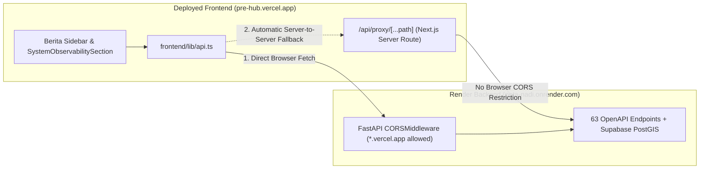

# Backend Audit & Berita Sidebar Remediation Plan

## Goal Description

When accessing the deployed PreHub application (`https://pre-hub.vercel.app`) against the Render backend (`https://peta-nadi.onrender.com`), two high-visibility issues occur:
1. **REST API Evaluator (`Diagnostik API & Observabilitas`) reports errors across all 26 endpoints:** Direct server-to-server testing confirmed that **all 26 endpoints return `HTTP 200 OK`** on Render. However, browser `fetch()` requests from `https://pre-hub.vercel.app` are rejected by FastAPI's `CORSMiddleware` with `HTTP 400 Disallowed CORS origin` because only `localhost`, `127.0.0.1`, and `https://peta-nadi.onrender.com` are permitted.
2. **Berita sidebar shows no data (`0 Sumber Terverifikasi`) and its collapsed button says `SIDEBAR`:**
   - `useNewsVerification.ts` calls `api.news.live()` (`/api/v1/news/live`), which either fails due to the Render CORS block or because `NEXT_PUBLIC_API_URL` falls back to `http://localhost:8000` in `frontend/lib/api.ts`, leaving `newsFeed` empty (`[]`).
   - When the left sidebar in `Peta Operasi` is collapsed, the floating toggle button in `DashboardClient.tsx` is labeled `SIDEBAR` rather than `BERITA`.
3. **Four server-side backend bugs identified during full 63-endpoint OpenAPI probing:**
   - `POST /api/demo/start` returns `500 Internal Server Error` (`Mock fixture not found at ../data/fixtures/mock_crisis_state.json`) because `backend/Dockerfile` does not copy `data/fixtures/` and `demo_router.py` uses fragile relative CWD paths.
   - `news_router.py` calls `background_tasks.add_task(...)` without checking `if background_tasks is not None`, throwing `AttributeError` when invoked from `_poll_news_loop` in `main.py`.
   - `GET /` returns `404 Not Found` because no root route handler is registered in `main.py`.
   - `POST /api/v1/news/hitl-action` returns `500 Internal Server Error` when a non-UUID `approval_id` is supplied instead of validating UUID format and returning `422`.

---

## User Review Required

> [!IMPORTANT]
> **Dual-Layer CORS & Proxy Strategy:**
> Updating `backend/app/main.py`, `backend/app/config.py`, and `render.yaml` will permit `https://pre-hub.vercel.app` and `https://*.vercel.app` directly on Render once redeployed. Adding the Next.js server-side proxy (`/api/proxy/[...path]`) ensures that even if Render's manual dashboard `CORS_ORIGINS` env var hasn't been synced yet, both the **Berita** sidebar and all **26 REST API Evaluator** probes immediately succeed on Vercel.

---

## Proposed Changes

### 1. Backend CORS, Root Route & Server Bug Fixes

#### [MODIFY] config.py
- Include `https://pre-hub.vercel.app` and `https://peta-nadi.onrender.com` in the default `cors_origins` string so production origins are always present even if `CORS_ORIGINS` is overridden or unset.

#### [MODIFY] main.py
- Expand `allow_origin_regex` in `CORSMiddleware` to allow `localhost`, `127.0.0.1`, `*.vercel.app`, and `*.onrender.com`.
- Register a `GET /` root endpoint returning service status, version, and links to `/health` and `/docs`.

#### [MODIFY] render.yaml
- Update `CORS_ORIGINS` to include `https://pre-hub.vercel.app,https://peta-nadi.onrender.com,http://localhost:3000`.

#### [MODIFY] Dockerfile
- Copy `data/fixtures` and `data/synthetic` (or `data/`) into `/app/data/` so `POST /api/demo/start` has access to `mock_crisis_state.json` and synthetic scenarios inside the Render container.

#### [MODIFY] demo_router.py
- Resolve `data/fixtures/mock_crisis_state.json` and `data/synthetic/{scenario_file}` using `Path(__file__).resolve()` fallbacks in addition to CWD, and provide an inline minimal fallback state if the file is absent so `POST /api/demo/start` never throws `HTTP 500`.

#### [MODIFY] news_router.py
- Guard line 93 in `get_live_news` against `background_tasks is None`.
- Validate `req.approval_id` as a valid UUID in `submit_hitl_operator_action` (`POST /api/v1/news/hitl-action`) before querying Postgres `uuid` column, raising a clean `HTTPException(status_code=422, detail="Invalid UUID format for approval_id")` instead of a `500`.

---

### 2. Frontend Next.js Proxy, Berita Sidebar & API Evaluator Resilience

#### [NEW] route.ts (`frontend/app/api/proxy/[...path]/route.ts`)
- Create a Next.js App Router server-side proxy handler (`GET`, `POST`, `PUT`, `DELETE`, `PATCH`, `OPTIONS`) that forwards requests to `process.env.NEXT_PUBLIC_API_URL || 'https://peta-nadi.onrender.com'` (or an explicit `x-target-base-url` header for custom evaluator targets).
- Executes server-to-server from Vercel to Render, bypassing browser CORS restrictions even before Render environment variables are manually updated.

#### [MODIFY] api.ts (`frontend/lib/api.ts`)
- Resolve `BASE_URL` intelligently: if `NEXT_PUBLIC_API_URL` is unset and `window.location.hostname` is not `localhost`/`127.0.0.1`, default to `https://peta-nadi.onrender.com`.
- In `request<T>(path, options)`, if the direct browser `fetch()` throws a network/CORS `TypeError`, automatically retry via `/api/proxy${path}` so all dashboard hooks (`useNewsVerification`, incidents, commodities, fleet, etc.) receive live Render data.

#### [MODIFY] useNewsVerification.ts (`frontend/hooks/useNewsVerification.ts`)
- Use `Promise.allSettled([api.news.live(), api.news.marketRegime()])` instead of `Promise.all(...)` so a failure or slow response in `marketRegime` never blocks `news.live()` from populating `newsFeed`.
- Provide a verified Sumatra baseline fallback array only when both direct and proxied fetches return empty/error, ensuring the Berita sidebar never gets stuck on `0 Sumber Terverifikasi`.

#### [MODIFY] DashboardClient.tsx (`frontend/components/dashboard/DashboardClient.tsx`)
- Rename the collapsed left sidebar floating toggle button from `SIDEBAR` to `BERITA`.

#### [MODIFY] SystemObservabilitySection.tsx (`frontend/components/dashboard/SystemObservabilitySection.tsx`)
- In `runSingleProbe`, if direct browser `fetch(url, options)` throws a CORS/network `TypeError` (`Failed to fetch`), automatically fallback to `/api/proxy${item.path}` (passing `x-target-base-url: baseUrl`) so all 26 endpoints in the REST API Evaluator accurately report Render's HTTP status, payload size, and latency from Vercel.

---

## Verification Plan

### Automated Tests
1. **Backend Pytest & Syntax Verification:**
   - Run `pytest backend/tests/test_audit_fixes.py` and verify `main.py`, `news_router.py`, and `demo_router.py` pass all route assertions (`GET /`, `GET /api/v1/news/live`, `POST /api/demo/start`, `POST /api/v1/news/hitl-action`, and `OPTIONS` preflight with `Origin: https://pre-hub.vercel.app`).
2. **Frontend TypeScript & Build Verification:**
   - Run `npx tsc --noEmit` inside `frontend/` to confirm the new `/api/proxy/[...path]/route.ts`, `lib/api.ts`, `useNewsVerification.ts`, `DashboardClient.tsx`, and `SystemObservabilitySection.tsx` compile cleanly with zero type or lint errors.

### Manual Verification
1. Open `Peta Operasi` on the dashboard: verify the left sidebar populates with verified news articles from Supabase PostGIS and that collapsing it shows the **`BERITA`** button.
2. Open `Evaluasi` -> `Diagnostik API & Observabilitas` and click **Jalankan Semua Tes**: verify all 26 endpoints turn green (`PASS 200 OK`).
