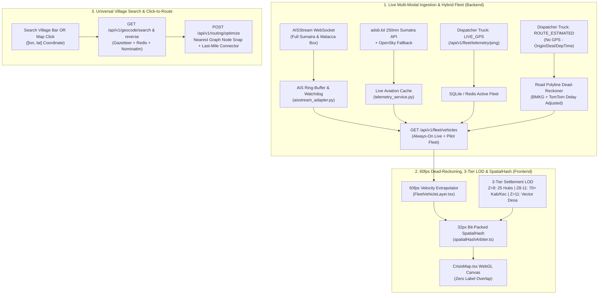

# Phase 62 Plan: PreHub Live Telemetry, Anti-Clutter Spatial Hash, News Deep-Linking & Universal Village Routing

## 1. Executive Summary & Architectural Decisions

Following our codebase audit of `pre-hub.vercel.app` and `https://peta-nadi.onrender.com`, external reference analysis of [`Vector897/Globot`](https://github.com/Vector897/Globot) and [`bilawalsidhu/gods-eye-view`](https://github.com/bilawalsidhu/gods-eye-view), and `/grill-me` alignment, Phase 62 executes four coordinated operational upgrades:

1. **Always-On Live Multi-Modal Telemetry & Hybrid Dispatcher Trucks**:
   - Retire the artificial **"Mode Simulasi"** filter gate that blanked out the map when turned off.
   - Stream **hundreds of live vessels** across the full Sumatra & Malacca Strait bounding box via `aisstream.io` and **live aircraft** over Sumatra via `adsb.lol` (with OpenSky fallback).
   - Keep **persistent Sumatra pilot partner manifests** (Bulog, Pelindo, Pos Logistik) active on the road network out-of-the-box, and upgrade [`FleetOnboardingModal.tsx`](file:///d:/College/Pidi.id/frontend/components/fleet/FleetOnboardingModal.tsx) so dispatchers can register both **GPS-Equipped Trucks (`LIVE_GPS`)** and **Non-GPS Subcontracted Trucks (`ROUTE_ESTIMATED`)** whose live positions are dead-reckoned along actual road geometry adjusted by live BMKG weather and TomTom traffic delays.
2. **Selective Adoption from `bilawalsidhu/gods-eye-view` & `Vector897/Globot`**:
   - **Do NOT dump synthetic global routes** from `Globot` or US/EU municipal catalogs from `gods-eye-view`.
   - **Port `gods-eye-view`'s 60 FPS Dead-Reckoning Engine (`motionModel`)** so vessels, aircraft, and trucks extrapolate smoothly along their velocity/route vectors between polling intervals.
   - **Port `gods-eye-view`'s Screen-Space `SpatialHash` Label Arbiter (`labelArbiter`)** (`32px` bit-packed grid `(cx << 14) | cy` + `2500ms` hysteresis) and **Zoom-Based Level of Detail (LOD)** so hundreds of live assets and settlement labels never overlap or tank WebGL frame rates.
3. **End-to-End News Article Permalink Resolution**:
   - Fix all 4 root causes where clicking news items bounced users to portal homepages (`kompas.com`, `detik.com`, `antaranews.com`).
4. **3-Tier Zoom LOD & Any-Village Search / Click-to-Route**:
   - Enable operators to navigate to, search for, or click **any remote village (*desa/kelurahan*) or *kecamatan*** across Sumatra without manual pin entry or screen clutter, and dynamically snap arbitrary coordinates into the deterministic CPU routing solver ([`cpu_routing_adapter.py`](file:///d:/College/Pidi.id/backend/app/adapters/cpu_routing_adapter.py)).

---

## 2. Architecture & Data Flow Diagram

---

## 3. Workstream Breakdown & File-Level Changes

### Workstream 1: Always-On Live Telemetry (AIS + ADS-B) & Hybrid Dispatcher Trucks

#### 1.1 Expand Live Maritime AIS to Full Sumatra & Malacca Strait with Watchdog Resilience
* **File**: `backend/app/adapters/aisstream_adapter.py`
* **Changes**:
  - Keep the 8 port anchorage bounding boxes for queue congestion metrics, and add a regional **Sumatra & Malacca Strait Macro Bounding Box** (`[[-6.2, 94.8], [6.2, 109.0]]`) to the `aisstream.io` subscription.
  - Store live vessel state in an in-memory bounded ring buffer (`MAX_LIVE_VESSELS = 600`, keyed by `mmsi`, storing `lat`, `lon`, `sog`, `cog`, `ship_name`, `ship_type`, `last_seen_ts`) with an automatic reconnection watchdog (`aisWatchdog` pattern from `gods-eye-view`).
  - Expose `get_live_ais_vessels() -> List[Dict[str, Any]]` so `telemetry_service.py` includes all active regional vessels alongside port queue statuses.

#### 1.2 Activate Unthrottled Live Aviation (ADS-B) via `adsb.lol` + OpenSky Fallback
* **File**: `backend/app/services/telemetry_service.py`
* **Changes**:
  - Implement `fetch_live_sumatra_aircraft()` using `https://api.adsb.lol/v2/point/0.0/101.5/250` (and northern/southern Sumatra subpoints `3.5/98.5/250`, `-3.5/104.5/250`) with a 30-second TTL cache so Render's shared IP never hits OpenSky 429 rate limits, falling back to `fetch_opensky_states()` if needed.
  - Map live ADS-B transponders (`hex`, `flight`, `lat`, `lon`, `gs` knots $\rightarrow$ km/h, `track` degrees, `alt_baro`) into `FleetVehicle` records with `telemetry_source: "ADSB_LIVE"`.

#### 1.3 Hybrid Dispatcher Truck Registration (`LIVE_GPS` vs `ROUTE_ESTIMATED`) & Persistent Pilot Manifests
* **Files**:
  - `backend/app/schemas/fleet_ingest.py`
  - `backend/app/schemas/fleet.py`
  - `backend/app/routers/fleet_ingest_router.py`
  - `backend/app/services/telemetry_service.py`
  - `frontend/components/fleet/FleetOnboardingModal.tsx`
* **Changes**:
  - Extend `SingleVehicleRegisterRequest` and `CustomVehicleRegisterPayload` with:
    - `tracking_mode: Literal["LIVE_GPS", "ROUTE_ESTIMATED"] = "ROUTE_ESTIMATED"`
    - `departure_time: Optional[str] = None` (ISO timestamp; defaults to registration time)
    - `origin_coords: Optional[List[float]] = None` (`[lon, lat]`)
    - `dest_coords: Optional[List[float]] = None` (`[lon, lat]`)
  - For **`LIVE_GPS`** trucks: display real-time webhook coordinates from `POST /api/v1/fleet/telemetry/ping`, with badge `GPS LIVE`.
  - For **`ROUTE_ESTIMATED`** trucks (when a dispatcher registers a truck without GPS hardware, plus our pre-seeded Sumatra partner dispatches from Bulog, Pelindo, and Pos Logistik): compute the road corridor path and interpolate the truck's live progress along the polyline using `(now - departure_time) * effective_speed_kmh`, dynamically slowed down if the corridor intersects an active BMKG flood/landslide zone or TomTom congestion segment. Display badge `RUTE TERESTIMASI (NON-GPS)`.
  - Remove the `isSimulationMode` filter in `frontend/hooks/useFleetVehicles.ts` and replace `#fleet-sim-toggle-btn` in `frontend/components/dashboard/DashboardClient.tsx` with a live telemetry status indicator & source filter.

#### 1.4 60 FPS Client-Side Dead-Reckoning (`motionModel`) & Zoom LOD
* **File**: `frontend/components/map/FleetVehicleLayer.tsx`
* **Changes**:
  - Port `gods-eye-view`'s dead-reckoning kinematics: between API polls, extrapolate `[lon, lat]` at 30–60 FPS along `bearing` at `speed_kmh` (clamped to corridor geometry for trucks, and great-circle COG/track for ships and aircraft).
  - Add Mapbox zoom-expression LOD:
    - At island view (`zoom < 7.5`), render live ships and planes as crisp, low-overhead directional dots (`circle-radius: 3.5px`) with callsign labels hidden unless hovered/selected.
    - At regional/tactical view (`zoom >= 7.5`), transition smoothly to full high-DPI directional sprites, velocity vectors, and decluttered callsign pills.

---

### Workstream 2: News Deep-Link Integrity & Canonical URL Resolution

#### 2.1 Preserve Article URLs in `OSINTHazardAgent`
* **File**: `agents/nodes/osint_hazard.py`
* **Changes**:
  - Include `"url": article.get("url") or article.get("link") or ""` and `"published_at": article.get("published_at")` inside `verified_citations.append({...})` so downstream tabs (`EvidenceTab.tsx` and `MitigationTab.tsx`) receive the exact article permalink.

#### 2.2 Unwrap Google News Redirects & Prioritize Direct ANTARA Sumatra Permalinks
* **Files**:
  - `backend/app/services/news_aggregator.py`
  - `backend/app/services/unified_news_ingestor.py`
* **Changes**:
  - Add a canonical URL resolver (`resolve_canonical_article_url(raw_url: str) -> str`) that decodes Google News RSS base64 article tokens (`CBMi...`) or follows `HEAD`/`GET` redirects with a standard browser `User-Agent` at ingestion time, storing the final article permalink in Supabase/Redis.
  - Ensure all external `<a href={...}>` tags in `DashboardClient.tsx`, `EvidenceTab.tsx`, and `MitigationTab.tsx` include `rel="noopener noreferrer"` and `referrerPolicy="no-referrer"` so Indonesian news portals (Kompas, Detik) do not bounce deep links back to their homepages.

#### 2.3 Fix Root-Domain Fallbacks in `useNewsVerification.ts` & `MitigationTab.tsx`
* **Files**:
  - `frontend/hooks/useNewsVerification.ts`
  - `frontend/components/sidebar/MitigationTab.tsx`
* **Changes**:
  - Replace the 6 root domain URLs (`https://sumut.antaranews.com`, etc.) in `FALLBACK_SUMATRA_NEWS` with real, verified article/bulletin permalinks, and add an in-app **Article Summary Quick-View Modal** when a user clicks a cached crisis bulletin whose external publisher page is offline.

---

### Workstream 3: 3-Tier Zoom LOD, Screen-Space `SpatialHash` Arbiter & Any-Village Routing

#### 3.1 Port `gods-eye-view`'s Screen-Space `SpatialHash` Label Arbiter
* **New File**: `frontend/lib/spatialHashArbiter.ts`
* **Changes**:
  - Implement a 32-pixel cell screen-space spatial hash (`(cx << 14) | cy`) with priority tiers:
    1. Selected Origin / Destination Pins & Active Crisis Alerts (Priority 100 — always visible)
    2. 25 Strategic Ports, Cargo Airports & Primary Hubs (Priority 80)
    3. 70+ Regency / Kecamatan Gazetteer Nodes (Priority 60)
    4. Active Fleet Callsigns (Priority 40 — fair-share quota capped)
    5. Local Village (*Desa/Kelurahan*) Labels (Priority 20 — visible at `z >= 11`)
  - Include `MIN_LIFETIME_MS = 2500` hysteresis so labels do not flicker during camera pans.

#### 3.2 Expose Gazetteer, Geocode Search & Reverse-Geocode Endpoints on Backend
* **New File**: `backend/app/routers/geocode_router.py` (mounted in `backend/app/main.py`)
* **Changes**:
  - `GET /api/v1/geocode/nodes`: Returns the 70+ `PAN_SUMATRA_GAZETTEER` Kabupaten/Kecamatan nodes + ADM2/ADM3 boundaries from `adm_boundary_service.py` for Tier-2 mid-zoom rendering.
  - `GET /api/v1/geocode/search?q=<query>`: Searches `HUB_NODES` + `PAN_SUMATRA_GAZETTEER` + Redis cache + OSM Nominatim (bounded to Sumatra `viewbox=95.0,6.0,109.0,-6.2`) so typing **any remote village, nagari, gampong, desa, or kecamatan** returns exact `[lon, lat]` coordinates and administrative hierarchy.
  - `GET /api/v1/geocode/reverse?lat=<lat>&lon=<lon>`: Resolves any map click coordinate into its village/kecamatan/kabupaten name.

#### 3.3 Upgrade `cpu_routing_adapter.py` & `CrisisMap.tsx` for Arbitrary Village Routing
* **Files**:
  - `backend/app/adapters/cpu_routing_adapter.py`
  - `backend/app/routers/routing_router.py`
  - `frontend/components/map/CrisisMap.tsx`
  - `frontend/lib/mapboxRoutingService.ts`
* **Changes**:
  - Extend `RoutingRequestPayload` and `solve_shortest_path()` to accept optional `origin_coords: Optional[List[float]]` (`[lon, lat]`) and `dest_coords: Optional[List[float]]`.
  - When a user selects a remote village (by searching its name or clicking the map), `cpu_routing_adapter.py` snaps `[lon, lat]` to the nearest Sumatra road graph node via Haversine distance, solves the hazard-aware k-shortest paths across the backbone graph, and seamlessly connects the village's exact `[lon, lat]` coordinate with `fetchMapboxDirections` last-mile road geometry.
  - Configure `CrisisMap.tsx` with the **3-Tier Zoom LOD**:
    - **Tier 1 (`z < 8`)**: 25 Core Ports/Airports/Hubs.
    - **Tier 2 (`z 8–11`)**: 70+ Sumatra Kabupaten/Kecamatan Gazetteer nodes.
    - **Tier 3 (`z > 11`)**: Interactive Mapbox vector settlement layers (`settlement-subdivision-label`, `settlement-minor-label`) with click-to-set Origin/Destination context popover.

---

## 4. Verification & Acceptance Criteria

1. **Always-On Telemetry Verification**:
   - Load dashboard with no manual toggles required $\rightarrow$ verify live AIS vessels across Malacca/Sumatra, live ADS-B aircraft, and persistent Sumatra partner trucks render simultaneously with 60fps dead-reckoning and zero label overlap.
   - Register both a `LIVE_GPS` truck and a `ROUTE_ESTIMATED` (non-GPS) truck via `FleetOnboardingModal.tsx` $\rightarrow$ verify both appear on the map with accurate badges and corridor interpolation.
2. **News Deep-Link Verification**:
   - Click news items in the left live feed, `EvidenceTab`, and `MitigationTab` citation pills $\rightarrow$ verify every link opens the specific article permalink (or in-app summary modal) and **never** bounces to a portal root homepage.
3. **Remote Village Navigation & Anti-Clutter Verification**:
   - Zoom from `z=5` (island view) $\rightarrow$ `z=9` (regency/kecamatan view) $\rightarrow$ `z=13` (village/desa view) and verify smooth 3-tier LOD progression governed by `spatialHashArbiter.ts`.
   - Search for a remote Sumatra village (or click directly on a village label on the map) $\rightarrow$ set as Origin or Destination $\rightarrow$ verify deterministic route calculation and last-mile road rendering.
