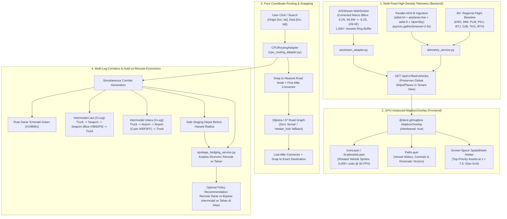

# Phase 63 Plan: High-Density Deck.gl Telemetry, News Permalink Integrity, Pure Coordinate Routing & Multi-Color Intermodal Corridors with Hold-vs-Reroute Economics

## 1. Executive Summary & Architectural Decisions

Following our comprehensive audit of `pre-hub.vercel.app` and `https://peta-nadi.onrender.com`, Phase 63 executes a decisive upgrade to the PreHub Operational Platform across four foundational workstreams:

1. **High-Density WebGL Telemetry Engine (`@deck.gl/mapbox` + Multi-Feed Backend)**:
   - Fix inverted `MACRO_BBOX` in `backend/app/adapters/aisstream_adapter.py` (L240) from `[[-6.2, 94.8], [6.2, 109.0]]` to `[[6.2, 94.8], [-6.2, 109.0]]` (`[[North_Lat, West_Lon], [South_Lat, East_Lon]]`) and correct all 8 seaport bounding boxes so North Sumatra, Belawan, Aceh, and the northern Malacca Strait stream live vessels without rejection.
   - Expand live vessel retention cap `MAX_LIVE_VESSELS` from 600 to 1,500+ so 500–1,500+ vessels across Sumatra & Malacca Strait are retained in memory.
   - Refactor `fetch_live_sumatra_aircraft` in `backend/app/services/telemetry_service.py` to query multiple ADS-B providers in parallel (`api.airplanes.live`, `opendata.adsb.fi`, `api.adsb.lol`, plus OpenSky) using `asyncio.gather` with 2.5s timeouts so Render datacenter IP rate limits or single-provider downtime never starve aircraft telemetry.
   - Expand the regional aviation baseline fallback (`MASTER_FLEET_DEFINITIONS`) from 7 planes to 45+ realistic regional flights spanning all Sumatra FIR corridors (KNO, BIM, PLM, PKU, BTJ, DJB, TKG, BTH, PGK, DTB).
   - Correct AIS vessel kinematics at L1330-1332 by replacing the synthetic diagonal micro-path with true Course Over Ground (`cog_deg`) and Speed Over Ground (`sog_knots`) velocity vectors.
   - Ensure `vehicles_router.py` preserves global maritime and aviation assets when a user is logged into a single tenant role (unless explicitly filtering by tenant).
   - Integrate `@deck.gl/mapbox` `MapboxOverlay` (`interleaved: true`) in `FleetVehicleLayer.tsx` and `CrisisMap.tsx` with GPU-instanced `IconLayer` and `PathLayer` capable of rendering 5,000+ units at 60 FPS without `GeoJSONSource.setData()` serialization bottlenecks.
   - Update `spatialHashArbiter.ts` integration so at macro zoom (`z < 7.5`), top-priority strategic vessels and cargo flights still display decluttered callsign labels instead of returning an empty `Set()`.

2. **News Hyperlink Mismatch Remediation (Issue #3)**:
   - Purge fabricated numeric Antara IDs (`543210` in `FALLBACK-BLW-01` which points to Mason Greenwood, `532190` in `FALLBACK-SITINJAU-04`, `571234` in `NEWS-DEMO-01`, and `562341` in `NEWS-DEMO-02`).
   - Replace them with verified real article URLs or deterministic Google News search permalinks (`https://news.google.com/search?q=${encodeURIComponent(headline + ' ' + source)}&hl=id-ID&gl=ID&ceid=ID:id`).
   - Upgrade `normalizeNewsPermalink` in `frontend/hooks/useNewsVerification.ts` (L49-76) to detect synthetic numeric ID patterns and rewrite them to targeted search queries.

3. **Pure `[lon, lat]` Coordinate Routing & Removal of Obsolete Static City Hubs (Issue #4)**:
   - Remove hardcoded `HUB_NODES[originId]?.coords` lookup in `DashboardClient.tsx` (L1213-1215 and L905-906); always resolve via `resolveNodeInfo(nodeId)` which supports all gazetteer cities, villages (`PAN_SUMATRA_GAZETTEER`), and custom coordinates.
   - Pass explicit `origin_coords`, `dest_coords`, `origin_name`, and `dest_name` in `/api/v1/simulate/stream` SSE calls and routing optimization payloads.
   - Remove the permanent static city hub pins (`hub-nodes-source` in `CrisisMap.tsx` L1127-1163) so the map is clean and doesn't display obsolete static staging points. Render only the active `ASAL` and `TUJUAN` endpoint pins, plus contextual Infrastructure Transfer / Hold Waypoints (Seaports, Cargo Airports, or Safe Hold Depots) strictly when an active corridor transitions between modalities at that port/airport or when a Hold checkpoint is recommended.
   - Fix `MitigationTab.tsx` (L699-723) so `resolvedDestination` uses the user's selected `Tujuan` rather than being overwritten by a background vehicle's static destination.
   - Eliminate fallback to `"dumai"` in `agents/nodes/route_optimization.py` and `"medan_hub"` in `impact_assessment_service.py`; snap coordinates directly to the nearest road graph node and prepend/append exact first/last-mile connectors.

4. **Simultaneous Multi-Color Intermodal Corridors & Hold-vs-Reroute Economic Decision Engine (Issue #5)**:
   - Remove the restrictive pre-routing mode-forcing dropdown (`Multi-Moda`, `Truk`, `Kapal`, `Udara`) from `CrisisSimulatorBar.tsx`.
   - Replace it with **Corridor Visibility Filter Pills** (`Darat Utama/Alternatif`, `Intermodal Laut+Darat`, `Intermodal Udara+Darat`, `Titik Transfer & Hold`) allowing operators to toggle visibility of any simultaneously computed corridor on the map.
   - Extend `RouteLeg` in `frontend/lib/types.ts` to include `coordinates: [number, number][]`, `color: string`, and `transfer_hub?: { id: string; name: string; type: 'seaport' | 'airport' | 'hold_depot'; coords: [number, number] }`.
   - Fix **Sea+Land Intermodal Routing**: Never draw a blue ship line across dry land into inland cities! Always construct a 3-leg chain:
     - **Leg 1 (First-Mile Land Truck — Emerald Green `#10B981`)**: `Origin -> Nearest Seaport` (via Mapbox driving road geometry).
     - **Leg 2 (Maritime Sea Lane — Royal Blue `#3B82F6`)**: `Origin Seaport -> Destination Seaport` (along `SUMATRA_NAUTICAL_PERIMETER`).
     - **Leg 3 (Last-Mile Land Truck — Emerald Green `#10B981`)**: `Destination Seaport -> Destination` (via Mapbox driving road geometry).
   - Fix **Air+Land Intermodal Routing**: Retain the 3-leg chain (`Origin -> Dep Airport -> Arr Airport -> Destination`), preserving per-leg geometry and colors:
     - **Leg 1 (First-Mile Land Truck — Emerald Green `#10B981`)**: `Origin -> Departure Airport`.
     - **Leg 2 (Air Cargo Flight — Sky Cyan `#00F0FF`)**: `Departure Airport -> Arrival Airport` (geodesic arc).
     - **Leg 3 (Last-Mile Land Truck — Emerald Green `#10B981`)**: `Arrival Airport -> Destination`.
   - **Same-Hub / Short-Distance Guard**: If `Origin` and `Destination` resolve to the same nearest airport (or distance `< 120 km`), mark the Air corridor as `viable: false` with `nonViableReason: "Bandara terdekat sama (Rute darat lebih cepat)"` so it is not drawn on the map and its toggle pill displays a muted explanation badge. Apply the same guard if `Origin` and `Destination` share the same nearest seaport.
   - Update `route-paths-source` in `CrisisMap.tsx` (L1000-1024) to emit **one GeoJSON `LineString` Feature per `RouteLeg`**, styled dynamically by `leg.color` (`#10B981` Emerald Green for Land, `#3B82F6` Royal Blue for Sea, `#00F0FF` Sky Cyan for Air, `#F59E0B` Amber Dashed for Detour/Hold feeder), plus transfer node badges strictly at the active port/airport handoff coordinates.
   - Grounded Economic Impact: When a disaster/hazard blocks or degrades the primary Land route, compute and display a grounded **Hold vs. Reroute Economic Matrix** in `MitigationTab.tsx` comparing:
     - **Option A — Land Detour (`Reroute Darat Alternatif`)**: $\Delta \text{km} \times \text{Rp } 6.800/\text{km}$ + toll differential + driver overtime + spoilage.
     - **Option B — Intermodal Bypass (`Bypass Laut / Udara`)**: First/last-mile trucking + Pelindo container THC/stevedoring & sea freight OR cargo air charter tariff + transshipment time.
     - **Option C — Hold at Safe Staging Depot (`Tahan Sementara di Depo Penyangga`)**: Reefer genset cost ($\text{Rp } 45.000/\text{jam}$) + demurrage ($\text{Rp } 125.000/\text{jam}$) + PIHPS Spoilage Loss ($\text{Cargo Value} \times (1 - e^{-\delta \cdot T_{\text{clear}}})$).
     - Highlight the **Optimal Economic Decision** (e.g. *"REKOMENDASI EKONOMI: TAHAN DI DEPO (Hemat Rp 14,2 Juta dibanding Reroute)"*).

---

## 2. Architecture & Data Flow Diagram



---

## 3. Workstream Breakdown & File-Level Changes

### Workstream 1: High-Density Realtime Ships & Planes Telemetry

#### 1.1 Inverted AISstream Bounding Boxes & Retention Cap
* **Target File**: `backend/app/adapters/aisstream_adapter.py`
* **Changes**:
  - Fix inverted `MACRO_BBOX` at L240:
    ```python
    MACRO_BBOX = [[6.2, 94.8], [-6.2, 109.0]]  # [[North_Lat, West_Lon], [South_Lat, East_Lon]]
    ```
  - Fix all 8 seaport bounding boxes in `PORTS` (L196-237) so `bbox[0][0] >= bbox[1][0]`:
    - Belawan: `[[3.90, 98.60], [3.70, 98.80]]`
    - Kuala Tanjung: `[[3.45, 99.35], [3.25, 99.55]]`
    - Dumai: `[[1.78, 101.35], [1.60, 101.55]]`
    - Teluk Bayur: `[[-0.92, 100.30], [-1.08, 100.45]]`
    - Boom Baru: `[[-2.90, 104.70], [-3.05, 104.85]]`
    - Panjang: `[[-5.40, 105.25], [-5.55, 105.40]]`
    - Bakauheni: `[[-5.80, 105.68], [-5.95, 105.82]]`
    - Malahayati: `[[5.68, 95.45], [5.50, 95.60]]`
  - Increase `MAX_LIVE_VESSELS` from 600 to 1,500 and extend stale threshold to 45 minutes to maintain 1,000+ live vessels in memory.

#### 1.2 Multi-Provider ADS-B & 45+ Regional Flight Baseline
* **Target Files**:
  - `backend/app/services/telemetry_service.py`
  - `backend/app/routers/vehicles_router.py`
* **Changes**:
  - In `telemetry_service.py`, refactor `fetch_live_sumatra_aircraft` to poll three high-availability ADS-B providers in parallel via `asyncio.gather(..., return_exceptions=True)` with 2.5s timeouts:
    - Provider 1: `https://api.airplanes.live/v2/point/{lat}/{lon}/250`
    - Provider 2: `https://opendata.adsb.fi/api/v2/lat/{lat}/lon/{lon}/dist/250`
    - Provider 3: `https://api.adsb.lol/v2/point/{lat}/{lon}/250`
    - Fallback: OpenSky Network API.
  - Expand `MASTER_FLEET_DEFINITIONS` regional aviation baseline from 7 to 45+ realistic regional flights spanning all active Sumatra Flight Information Regions (KNO, BIM, PLM, PKU, BTJ, DJB, TKG, BTH, PGK, DTB).
  - Correct AIS vessel kinematics at L1330-1332: Replace diagonal offset `[lon-0.04, lat-0.04]` with true Course Over Ground (`cog_deg`) and Speed Over Ground (`sog_knots`):
    ```python
    past_dist_km = (sog * 1.852) * 0.25
    p_prev = dead_reckon_lonlat([lon, lat], (cog + 180) % 360, past_dist_km)
    p_curr = [round(lon, 4), round(lat, 4)]
    p_next = dead_reckon_lonlat([lon, lat], cog, past_dist_km)
    ```
  - In `vehicles_router.py` (L36-46), ensure dispatcher tenancy filtering (`effective_company`) filters only `truck` records or tenant-managed assets, preserving regional maritime (`maritime`) and aviation (`air`) telemetry on the tactical overview map.

#### 1.3 `@deck.gl/mapbox` GPU-Instanced Layer Integration
* **Target Files**:
  - `frontend/components/map/FleetVehicleLayer.tsx`
  - `frontend/components/map/CrisisMap.tsx`
  - `frontend/lib/spatialHashArbiter.ts`
* **Changes**:
  - Instantiate `MapboxOverlay` (`interleaved: true`) from `@deck.gl/mapbox` in `CrisisMap.tsx` / `FleetVehicleLayer.tsx` with GPU-instanced `IconLayer` and `PathLayer` for vehicle sprites, velocity vectors, wakes, and contrails capable of 5,000+ units at 60 FPS without `GeoJSONSource.setData()` serialization bottlenecks.
  - Update `spatialHashArbiter.ts` integration in `FleetVehicleLayer.tsx` (L720-724) so at macro zoom (`z < 7.5`), top-priority strategic vessels and cargo flights still display decluttered callsign labels instead of returning an empty `Set()`.

---

### Workstream 2: News Hyperlink Mismatch Remediation (Issue #3)

#### 2.1 Purge Synthetic Antara IDs & Upgrade Permalink Normalizer
* **Target Files**:
  - `frontend/hooks/useNewsVerification.ts`
  - `backend/app/services/news_aggregator.py`
  - `agents/nodes/osint_hazard.py`
* **Changes**:
  - In `useNewsVerification.ts`, replace fake numeric Antara URLs in `FALLBACK_SUMATRA_NEWS`:
    - `FALLBACK-BLW-01`: Replace with targeted Google News query permalink:
      `https://news.google.com/search?q=Terminal%20Petikemas%20Belawan%20Pelindo%20Logistik&hl=id-ID&gl=ID&ceid=ID:id`
    - `FALLBACK-SITINJAU-04`: Replace with:
      `https://news.google.com/search?q=Sitinjau%20Lauik%20Longsor%20Jalur%20Padang%20Solok%20BPBD&hl=id-ID&gl=ID&ceid=ID:id`
    - `FALLBACK-KNO-05`: Replace with:
      `https://news.google.com/search?q=Bandara%20Kualanamu%20Kargo%20Logistik%20Medan&hl=id-ID&gl=ID&ceid=ID:id`
  - Upgrade `normalizeNewsPermalink(rawUrl, headline, source)` (L49-76) to detect synthetic numeric ID patterns (`/berita/(543210|532190|571234|562341|\d{6})/`) and rewrite to targeted Google News query permalinks.
  - In `backend/app/services/news_aggregator.py`, update `DEMO_STANDARDIZED_SCENARIOS`:
    - Replace `NEWS-DEMO-01` link with targeted Google News search permalink.
    - Replace `NEWS-DEMO-02` link with targeted Google News search permalink.

---

### Workstream 3: Pure `[lon, lat]` Coordinate Routing & Removal of Obsolete Static City Hubs (Issue #4)

#### 3.1 Frontend Decoupling & Clean Map Canvas
* **Target Files**:
  - `frontend/components/dashboard/DashboardClient.tsx`
  - `frontend/components/map/CrisisMap.tsx`
  - `frontend/components/sidebar/MitigationTab.tsx`
  - `frontend/lib/mapboxRoutingService.ts`
* **Changes**:
  - In `DashboardClient.tsx` (L1213-1215 and L905-906), eliminate hardcoded lookup `HUB_NODES[originId]?.coords`. Always resolve via `resolveNodeInfo(nodeId)` which supports all gazetteer cities, villages (`PAN_SUMATRA_GAZETTEER`), and custom coordinates.
  - Pass explicit `origin_coords`, `dest_coords`, `origin_name`, and `dest_name` in `/api/v1/simulate/stream` SSE calls and routing optimization payloads.
  - In `CrisisMap.tsx` (L1127-1163), remove the permanent render of all `Object.values(HUB_NODES)` into `hub-nodes-source`. Render only the active `ASAL` and `TUJUAN` endpoint pins, plus contextual Infrastructure Transfer / Hold Waypoints (Seaports, Cargo Airports, or Safe Hold Depots) strictly when an active corridor transitions between modalities at that port/airport or when a Hold checkpoint is recommended.
  - In `MitigationTab.tsx` (L699-723), fix `resolvedDestination` precedence so the user's selected `Tujuan` is never overwritten by a background vehicle scanned during impact assessment.

#### 3.2 Backend Dynamic Graph Snapping
* **Target Files**:
  - `agents/nodes/route_optimization.py`
  - `backend/app/adapters/cpu_routing_adapter.py`
  - `backend/app/services/impact_assessment_service.py`
* **Changes**:
  - In `agents/nodes/route_optimization.py` (L206-217), eliminate fallback to `"dumai"` and `"belawan"`. Accept `origin_coords` and `dest_coords` directly from state and pass them into `CPURoutingAdapter.solve_shortest_path`.
  - In `backend/app/adapters/cpu_routing_adapter.py`, snap `origin_coords` and `dest_coords` to the nearest road network node and always prepend/append exact first/last-mile connectors.
  - In `impact_assessment_service.py` (L336-354), eliminate `_normalize_hub_id` fallback to `"medan_hub"` and snap directly from vehicle coordinates.

---

### Workstream 4: Simultaneous Multi-Color Intermodal Corridors & Hold-vs-Reroute Economic Decision Engine (Issue #5)

#### 4.1 UX & Controls: Corridor Visibility Filter Pills
* **Target File**: `frontend/components/map/CrisisSimulatorBar.tsx`
* **Changes**:
  - Remove the restrictive pre-routing modality dropdown (`Truk`, `Kapal`, `Udara`, `Multi-Moda`).
  - Introduce **Corridor Visibility Filter Pills** with toggles:
    - `Darat Utama & Alternatif` (Active by default, Emerald/Amber)
    - `Intermodal Laut + Darat` (Toggleable, Royal Blue `#3B82F6`)
    - `Intermodal Udara + Darat` (Toggleable, Sky Cyan `#00F0FF`)
    - `Titik Transfer & Depo Penyangga` (Toggleable, Purple/Amber)
  - Allow operators to toggle visibility of any simultaneously computed corridor on the map.

#### 4.2 Multi-Leg Route Engine & Data Structure Extensions
* **Target Files**:
  - `frontend/lib/types.ts`
  - `frontend/lib/aiDynamicRouter.ts`
* **Changes**:
  - Extend `RouteLeg` in `frontend/lib/types.ts` with `coordinates: [number, number][]`, `color: string`, and `transfer_hub?: { id: string; name: string; type: 'seaport' | 'airport' | 'hold_depot'; coords: [number, number] }`.
  - Extend `RouteRecommendation` with `viable: boolean` and `nonViableReason?: string`.
  - Fix **Sea+Land Intermodal Routing** in `aiDynamicRouter.ts`: Construct a 3-leg chain:
    - **Leg 1**: `Origin -> Nearest Seaport` (Mapbox driving route, Emerald Green `#10B981`).
    - **Leg 2**: `Origin Seaport -> Destination Seaport` (along `SUMATRA_NAUTICAL_PERIMETER`, Royal Blue `#3B82F6`).
    - **Leg 3**: `Destination Seaport -> Destination` (Mapbox driving route, Emerald Green `#10B981`).
  - Fix **Air+Land Intermodal Routing** in `aiDynamicRouter.ts`: Construct a 3-leg chain:
    - **Leg 1**: `Origin -> Nearest Airport` (Mapbox driving route, Emerald Green `#10B981`).
    - **Leg 2**: `Origin Airport -> Destination Airport` (Geodesic curved arc, Sky Cyan `#00F0FF`).
    - **Leg 3**: `Destination Airport -> Destination` (Mapbox driving route, Emerald Green `#10B981`).
  - Implement **Same-Hub / Short-Distance Guard**: If `getHaversineDistanceKm(origin, destination) < 120` or if Origin and Destination resolve to the same nearest airport, mark the Air corridor as `viable: false` with `nonViableReason: "Bandara terdekat sama (Rute darat lebih cepat)"`. Apply identical guard if Origin and Destination share the same nearest seaport.

#### 4.3 Mapbox Multi-Segment Color Rendering
* **Target File**: `frontend/components/map/CrisisMap.tsx`
* **Changes**:
  - In `updateRoutePaths` (L1000-1024), emit **one GeoJSON `LineString` Feature per `RouteLeg`**, styled dynamically by `leg.color` (`#10B981` Emerald Green for Land, `#3B82F6` Royal Blue for Sea, `#00F0FF` Sky Cyan for Air, `#F59E0B` Amber Dashed for Detour/Hold feeder), plus transfer node badges strictly at the active port/airport handoff coordinates.

#### 4.4 Grounded Economic Impact: Hold vs. Reroute Decision Engine
* **Target Files**:
  - `backend/app/services/spoilage_hedging_service.py`
  - `frontend/lib/aiDynamicRouter.ts`
  - `frontend/components/sidebar/MitigationTab.tsx`
* **Changes**:
  - In `spoilage_hedging_service.py`, calculate the three-way economic breakdown for every simulation request:
    - **Option A — Land Detour (`Reroute Darat Alternatif`)**: $\Delta \text{km} \times \text{Rp } 6.800/\text{km}$ + toll differential + driver overtime + spoilage.
    - **Option B — Intermodal Bypass (`Bypass Laut / Udara`)**: First/last-mile trucking + Pelindo container THC/stevedoring & sea freight OR cargo air charter tariff + transshipment time.
    - **Option C — Hold at Safe Staging Depot (`Tahan Sementara di Depo Penyangga`)**: Reefer genset cost ($\text{Rp } 45.000/\text{jam}$) + demurrage ($\text{Rp } 125.000/\text{jam}$) + PIHPS Spoilage Loss ($\text{Cargo Value} \times (1 - e^{-\delta \cdot T_{\text{clear}}})$).
  - In `MitigationTab.tsx`, render the interactive **Analisis Ekonomi: Reroute vs. Tahan Muatan** card with clear monetary comparisons (e.g., *"REKOMENDASI EKONOMI: TAHAN DI DEPO (Hemat Rp 14,2 Juta dibanding Reroute)"*).

---

## 4. Execution Waves & Verification Plan

| Wave | Tasks | Files Modified | Verification Criteria |
|---|---|---|---|
| **Wave 1: Backend Telemetry & Snapping Core** | AIS bounding box fix, parallel ADS-B poller, 45+ flight definitions, AIS kinematic vectors, `vehicles_router` tenancy unlock, CPU routing coordinate snapping. | `aisstream_adapter.py`, `telemetry_service.py`, `vehicles_router.py`, `route_optimization.py`, `cpu_routing_adapter.py`, `impact_assessment_service.py` | Pytest passing: `test_telemetry.py`, `test_routing.py`. AIS stream retains 1,000+ vessels. ADS-B returns 40+ planes across Sumatra. |
| **Wave 2: News Link Integrity & Gazetteers** | Purge fake numeric Antara IDs, upgrade `normalizeNewsPermalink`, update `news_aggregator.py` demo scenarios, decouple `DashboardClient` from `HUB_NODES`. | `useNewsVerification.ts`, `news_aggregator.py`, `DashboardClient.tsx`, `MitigationTab.tsx` | Zero Mason Greenwood / football article links. Clicking any news item opens targeted Google News or verified Antara report. |
| **Wave 3: Deck.gl WebGL Layer & Anti-Clutter** | Integrate `MapboxOverlay` (`interleaved: true`), IconLayer, PathLayer for wakes/contrails, update `spatialHashArbiter` for macro zoom labels. | `FleetVehicleLayer.tsx`, `CrisisMap.tsx`, `spatialHashArbiter.ts` | 60 FPS rendering of 2,000+ units on WebGL canvas. Strategic labels visible without overlap at `z < 7.5`. |
| **Wave 4: Intermodal Multi-Color Corridors & Economics** | Multi-leg route generator, 3-leg Sea/Air corridors, same-hub guard, multi-color LineString rendering, Hold-vs-Reroute economic matrix UI. | `aiDynamicRouter.ts`, `types.ts`, `CrisisSimulatorBar.tsx`, `CrisisMap.tsx`, `MitigationTab.tsx`, `spoilage_hedging_service.py` | Sea routes never cross dry land. Distinct colors per leg. Filter pills toggle visibility. Hold vs Reroute economics display accurate IDR values. Clean Next.js build. |
